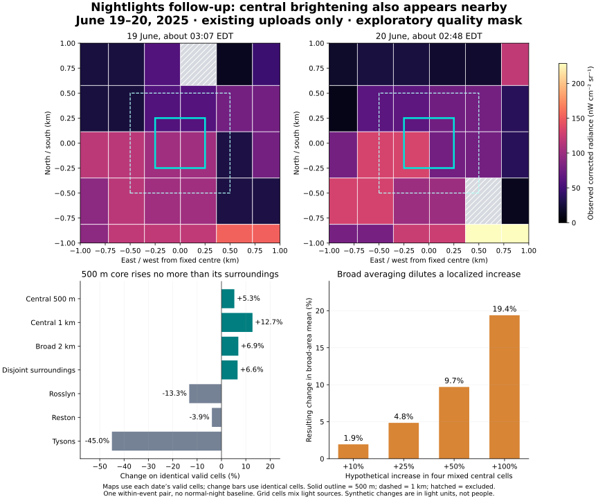

# Further tests using the existing NASA downloads

**16 October 2026. We can measure a change in light after relaxing an overly restrictive exploratory filter, but this batch does not identify a change caused by overnight staffing. The smallest building-centred area brightened no more than its surroundings.**

The first attempt stopped at quality coverage. This follow-up goes further: it measures corrected brightness, compares identical pixels between nights, tests smaller areas and simulates a localized increase. It uses the same 18 uploaded files, with no new satellite observations or data fees. The [follow-up protocol](FOLLOWUP_PROTOCOL.md) was written and hashed before brightness inspection; the earlier quality results and event identities were already known. This remains exploratory research.

## Were our thresholds too strict?

**For exploratory measurement, yes: the extra upstream stray-light veto discarded useful candidate observations, including the central cells.** On June 19, all four cells intersecting the central 500 m square had high-quality corrected-light retrievals and clear-sky classifications, but our additional A1 flag rule rejected all four. On June 20 it rejected three of the four, leaving only 36.9% of the small square's area. No central cell survived that rule on both nights.

Allowing the stray-light-only A1 flag, while retaining high-quality corrected retrievals, clear sky and the other exclusions, restores all four cells on both nights. For the original 2 km square it restores **92.0% common valid area**, enough to compare the same locations rather than let changing cloud holes impersonate a brightness change.

This is evidence that the original rule was too restrictive for this investigation, **not proof that the recovered observations are free of stray-light error or that the recovered variation is relevant to staffing**. NASA's corrected product includes a stray-light correction; residual accuracy still needs validation for the particular signal size. The original failed screen stays on record.

The filter also changes which places are represented. On June 19, the retained unflagged subset averaged 122.9 radiance units, while the recovered stray-light-only subset averaged 59.3. On June 20 those subset means were 140.7 and 54.5. These are different spatial subsets, so their difference cannot estimate instrument bias. They show why lowering an area threshold and averaging whatever remains would be dangerous.

## What changed between the two usable June nights?

These observations were acquired at approximately 03:07 on June 19 and 02:48 on June 20, Washington time. For each row below, both means use exactly the same valid native-grid cells and area weights. The 75% coverage threshold remains in force. No ordinary-night baseline is available, so these are **two-night changes, not anomalies**.

| Fixed area | Common valid area | Earlier mean | Later mean | Change |
|---|---:|---:|---:|---:|
| Central 500 m square | 100.0% | 90.53 | 95.32 | **+5.3%** |
| Central 1 km square | 98.0% | 80.86 | 91.16 | +12.7% |
| Original 2 km square | 92.0% | 74.29 | 79.44 | **+6.9%** |
| Surroundings, excluding every central raster cell | 90.4% | 72.87 | 77.70 | **+6.6%** |
| Rosslyn comparison area | 99.7% | 62.79 | 54.47 | −13.3% |
| Reston comparison area | 100.0% | 66.85 | 64.21 | −3.9% |
| Tysons comparison area | 97.9% | 245.58 | 135.06 | −45.0% |

Means are observed corrected radiance in nW cm⁻² sr⁻¹. They are not employee counts, total emitted power, or interchangeable absolute brightness baselines for different neighbourhoods. The central areas are analyst-defined squares, not building outlines.

The small central square rises **1.3 percentage points less** than its disjoint surroundings. The 1 km square rises more, so the result also depends on spatial scale; the increase is not strongest in the smallest building-centred aperture. The four central cell changes are heterogeneous rather than a uniform brightening. This is not a clean signature of the building's windows becoming brighter.

Subtracting the median change of the three distant comparison areas gives an apparently impressive **+20.2 percentage points** for the broad target. That number is descriptive and fragile: the controls themselves fall by very different amounts, while the local surroundings rise alongside the centre. It would be easy to turn that contrast into an exciting story without establishing its cause.

These are the work nights of June 18 and June 19, immediately around Juneteenth. Holiday patterns, different lighting schedules and observation geometry remain competing explanations. At a central sample cell, sensor zenith changes from about 5.0° to 24.9° and moon illumination from 44.2% to 33.1%. The product applies corrections, but this batch cannot estimate their residual error. Two nights cannot supply a noise distribution, significance test or false-alarm rate.



The maps show each date's valid cells; the change bars use the intersection valid on both dates. Hatching means excluded, not dark. The solid outline marks the nominal 500 m aperture; the dashed outline marks 1 km. These are raster diagrams without a building-footprint overlay.

## Can we isolate the building itself?

**Only weakly with these files.** The nominal 500 m square has area 0.25 km², but it intersects four map cells whose full grid footprints cover **0.668 km²**. Fractionally weighting those cells does not create subpixel observations. The underlying DNB measurement footprint is about **742 m**, according to [NASA's Collection 2 guide, section 3.3](https://landweb.modaps.eosdis.nasa.gov/data/userguide/BlackMarbleUserGuide_Collection2.0_20241203.pdf); the [instrument product description](https://ladsweb.modaps.eosdis.nasa.gov/missions-and-measurements/products/VNP02DNB) rounds this to 750 m. Adjacent map cells therefore are not independent building measurements.

The central aperture is 28% brighter than its disjoint surroundings on June 19, 27% on June 20, 42% on January 1 and 48% on February 27, under the exploratory mask and each date's available coverage. Thus it is possible to measure a brighter central patch. Those ratios are **not** a matched seasonal time series or evidence about window lighting. Fixed exterior lighting, parking, roads and nearby buildings can contribute; even disjoint raster cells may share the sensor's spatial response.

January and February still each have only one usable date in their supplied windows. A single image can provide a level and spatial contrast but cannot establish within-window brightening. June remains the only eligible within-event pair across all tested scenarios. There are no known normally staffed versus unusually staffed nights in this batch.

## How much could broad aggregation hide?

On the first usable scene, June 19, the four central mixed cells contribute **19.39%** of the valid broad square's area-weighted light. We increased their measured light in software while holding every mask and other cell fixed:

| Hypothetical increase in those four cells | Change in broad-area mean |
|---|---:|
| +10% | +1.94% |
| +25% | +4.85% |
| +50% | +9.70% |
| +100% | +19.39% |

This is deliberately optimistic: it boosts entire mixed cells, not just the building's contribution to them. It measures arithmetic dilution, not detection power. The actual building's share is unknown, and no conversion from extra people to extra light is justified. A staff increase may produce no exterior light change at all.

## What would answer the overnight-work question?

The missing ingredient is **independent ground truth at the overpass hour**. More unlabelled event images would not solve that. A useful validation design would use a large consenting civilian office or institutional campus with aggregate shift records or a documented change in operating hours, and separately observed interior/window and exterior lighting. No individual movement records are needed.

Use a two-link test:

1. **Work to light:** on independently known normal and unusually staffed nights, does extra occupancy actually change visible window/exterior light around 01:00–03:30? Record aggregate staffing bands and lighting state without identifying workers. A repeated lights-on/off comparison can establish the physical light response; it alone does not establish the occupancy link.
2. **Light to satellite:** on sufficiently clear overpasses, does the fixed satellite aperture recover those independently established changes relative to adjacent areas? Hold geometry, quality rules and comparison areas fixed; record view angle, weather, lunar conditions and publication times. Use repeated matched nights across operating states and reserve later nights for checking a rule chosen on earlier data.

Set the number of nights from an initial variance estimate rather than inventing a power calculation now. A single blackout or office-switching demonstration would be a useful physical positive control but not staffing validation. Known public operating schedules could provide cheaper preliminary labels, but they would remain proxies unless actual overnight occupancy and lighting are checked.

**Decision:** keep the relaxed mask as an explicitly exploratory way to use the existing corrected observations. Do not deploy an alert or claim a pre-operation detection. The strongest result of this follow-up is that the central light is measurable, the original extra veto suppressed it, and the observed June increase is also present nearby. Proving a relation to overnight work now needs independent labels, not more threshold adjustment.

## Reproduction and verification

New files: `code/followup_brightness.py`, `code/verify_followup.py`, `code/plot_followup.py`, `evidence/followup_results.json`, `evidence/followup_pixel_values.json`, `evidence/followup_preanalysis.json`, and `evidence/followup_verification.json`.

After reproducing the earlier extraction from the three uploads, run:

```sh
python3 code/followup_brightness.py
python3 code/verify_followup.py
python3 code/plot_followup.py
```

The first script needs h5py and NumPy; the plot also needs Matplotlib. Tested versions are in [requirements-followup.txt](requirements-followup.txt). The independent verification uses Python's standard library and the released small extracts, so it does not require NASA credentials or the large raw files. It checks **252 regional/mask summaries, 36 within-event pair/mask summaries, four direct synthetic perturbations, and the disjoint core/surrounding cell sets**. All checks passed. The extract contains 1,548 region/pixel records; repeated cells in nested regions are not extra independent observations.

The follow-up protocol hash is `1e08d3c79b686bb53375a8b4ccb5c079067bb2118da85be67b145335cc041064`. The frozen original quality screen and all its unscorable results remain preserved. No public-facing model has been trained, no people counted, and no new data collection scheduled.
