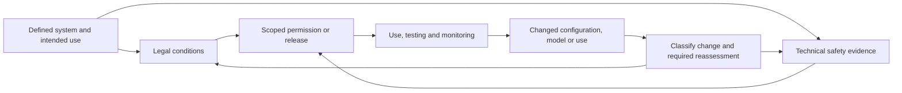

# Where the brakes bite: permissions, assurance dependencies and changing software

**Editorial review accepted: 25 October 2026, 23:05 UTC.** The [independent acceptance and audit records](https://drive.google.com/file/d/1VPy6SfRsk5_ubM_U674VZKkPTY-09bEO/view?usp=drivesdk) cover the bounded claims and artifacts in commit `b2824b4`; this final publication adds status and pointer updates. Acceptance is not certification of weapon safety, legal compliance or effectiveness.

**Evidence cutoff: 25 October 2026.** New work anchored to immutable F4 commit `fa55e8d3d7c69bfc1051279185c7c88df8e92cb6`.

A Dutch Defence Staff document stamped 18 June 2024 permits use of SMASH2000 under restrictions drawn from an earlier legal opinion and requires operators to be instructed accordingly. A separate July record acknowledges temporary conditional technical release while testing capacity was awaited. An April configuration-change condition and a May 2025 account of extensive testing extend the trail. Released in October 2026, these records show conditions entering actual administrative decisions. They do more than announce that a review board exists. [Disclosed bundle, PDF pp.111,120,124,162–163](https://open.overheid.nl/details/edb67d95-6af9-4694-874e-73cd01880968).

Elsewhere, the records show different consequences. A Marine Corps release describes temporary test clearance before full weapon-safety certification. A contractor says a safety board declined releases for US Air Force personnel, changing their participation in an experiment. British procurement notices cite rebuilding assurance evidence as a reason to retain suppliers. Italian records show bounded flight permissions. NATO auditors distinguish evidence of testing from evidence that testing expenses were properly substantiated.

These are meaningful governance findings. A public record can establish a real permission, condition or restriction without exposing every technical file behind it. A condition is not proof of compliance, a test is not fleet approval, and a financial-control finding is not a failed weapon safeguard. The investigation supports neither “there are no brakes” nor “the boards make autonomous weapons safe.”

## Two strong story hooks and a related accountability lead

1. **Follow Dutch legal conditions into actual permission.** The October disclosure links a restrictive opinion to 2023 advice and a separate June 2024 permission, with technical-release and configuration-change records alongside it. The strongest benign explanation is that restrictions carried through as intended. Later-version decisions and implementation remain reporting questions, not a proven bypass. The disclosure searched records only through 12 January 2026. [Bundle](https://open.overheid.nl/details/edb67d95-6af9-4694-874e-73cd01880968), [2026 answer 16](https://zoek.officielebekendmakingen.nl/ah-tk-20252026-1049.html).
2. **Assurance evidence can become a procurement dependency.** MOD’s CARRION notices justify proposed noncompetitive continuation partly through the cost/risk of rebuilding integration and assurance evidence. Applied Intuition’s proposed 27 October signature remains future. Sensible continuity for a bounded prototype is plausible; permanent lock-in, incurred rebuilding costs and withheld data rights are unproved. [Original notice](https://www.find-tender.service.gov.uk/Notice/095965-2026), [government mirror](https://www.sell2wales.gov.wales/search/show/search_view.aspx?ID=OCT666902&catID=).
3. **Who verifies paid testing, and what changed after the audit?** DIANA’s audit identifies financial-substantiation gaps while management reports accepted technical test reports. Clean opinions concern resubmitted/corrected statements. June 2026 guidance for incoming 2027 applicants requires use justification and retained receipts and rejects automatic certification fast-tracking. This is a supported accountability lead, not a third direct revelation of failed weapon restraints. Actual remediation remains a question. [Audit and response](https://www.nato.int/content/dam/nato/webready/documents/iban/financial-audits/PO%282025%290336%20NU%20ENG%20-%20DIANA%202024%20FS%20-%20public%20disclosure.pdf), [FAQ](https://www.diana.nato.int/connect/-nato-diana-challenge-call-qa-your-key-questions-answered-2.html).

No global first-to-report claim is established. Patents and US developmental-testing cases provide discovery and context; they are not promoted as proven deployed legal governors or AI-failure exposés.

## What the records establish

| Record | Observable consequence | Evidence boundary |
|---|---|---|
| Dutch SMASH permission/release records | Conditional permission, instruction and configuration-change permission requirement | No proof of field compliance or continuing 2026 permission |
| Mjölnir/SkyRaider test | NAVAIR interim test clearance; full WSESRB adoption/certification incomplete | Military account, not signed clearance or AI-specific failure investigation |
| Trident Elding/NASAMS | Reported refusal of releases for USAF personnel; simulated activity substituted | Contractor account; not rejection of the whole experiment or an AI determination |
| CARRION | Assurance-rebuilding risk cited for proposed supplier continuity | Not executed award, permanent lock-in or quantified assurance bill |
| ENAC V-BAT entries | Bounded operator flight permissions | Specific operators/periods, not universal AI-stack or weapon approval |
| DIANA audit/response | Financial evidence gaps and stated improvements | Accepted technical reports and unqualified opinions must accompany criticism |

Legal review, engineering safety, platform certification, acquisition approval and a commander’s use-of-force decision can each constrain activity. They are not interchangeable. Human authorisation also depends on information, time, workload and authority. Version and mission metadata can help trace changes without publishing weapon design or operational details.

This is an analytical map, not a universal workflow or a requirement that every meaningful public case expose the entire chain.

## Dutch SMASH: more than a historical advisory opinion

Opinion 18, published 13 August 2021, imposes training and use restrictions reflecting wrong-lock and overconfidence concerns. Disclosed March 2023 Defence Staff advice BS2023006996 says the minister approved that opinion on 13 July 2021 and carries its conditions into proposed operational use. That advice is not the final disposition of its proposal. [Opinion](https://www.rijksoverheid.nl/documenten/2021/08/13/advies-18-gebruik-smash-2000-smart-shooter), [bundle pp.20–22](https://open.overheid.nl/details/edb67d95-6af9-4694-874e-73cd01880968).

The separate DOPS record BS2024009679, stamped 18 June 2024, expressly grants conditional permission for 1 April 2024–31 May 2025 and requires operator instruction. Its period begins before the stamp. That sequence warrants an explanation; it does not prove unauthorized earlier use or backdating. Actual-use dates and any earlier authority are unknown, and redactions are not reconstructed. A February 2026 answer calls the opinion binding and promises reassessment of new versions. [Permission p.111](https://open.overheid.nl/details/edb67d95-6af9-4694-874e-73cd01880968), [answer 16](https://zoek.officielebekendmakingen.nl/ah-tk-20252026-1049.html).

July 2024 note BS2024021515 says testing capacity was awaited and acknowledges COMMIT/GWS conditional technical release. Associated 29 April 2024 advice COMMIT2024005557 requires normsetter consultation/permission for configuration changes. A 2 May 2025 note, COMMIT2025008166, says extensive testing had occurred. That later official account prevents a misleading narrative of permanently unresolved testing, but is not an independent test-results audit. A February 2024 type-classification exemption appears as a request with redacted decision: neither grant nor denial is claimed. [Records pp.120,122–124,162–163](https://open.overheid.nl/details/edb67d95-6af9-4694-874e-73cd01880968).

The October 2026 disclosure searched 1 January 2020–12 January 2026 and found 18 records. Legal permission, technical release and later test accounts concern distinct decisions/configurations. They cannot be combined into an assertion that a new model was approved or legal conditions waived. The [legal dossier](memos/05-article-36-legal-reviews-and-software-updates.md) preserves the complete governance chronology and unresolved questions.

## US safety: scoped gates and a test-versus-adoption boundary

MIL-STD-882E Change 1 is dated 27 September 2023. Software control category and mishap severity jointly determine criticality and rigor at function level. Autonomy is not automatically SwCI 1. Formal risk acceptance for incomplete rigor is not proof of a named AI waiver and cannot waive legal obligations. [Standard](https://www.cto.mil/wp-content/uploads/2025/07/MIL-STD-882E-w_CHANGE-1.pdf).

The highest-criticality supervised-ML assurance boundary was already identified in the 2024 endorsed LOR work. January 2026’s Machine Learning System Safety Engineering Guide expands that work; it does not first expose it. The guide is informational/tailorable. It distinguishes almost-always deterministic inference from uncertain generalisation, discusses independently assured safeguards and renewed testing after retraining, and does not prohibit every highest-criticality ML deployment. [2024 antecedent](https://www.cto.mil/wp-content/uploads/2025/08/Memo-Endorse-LOR-Objectives-DistroA.pdf), [2026 guide](https://www.cto.mil/wp-content/uploads/2026/01/MLSSEG-8January2026-Cleared.pdf).

Appendix B, printed pp.116–118, offers data cards, contractor analysis and government testing where proprietary data is unavailable. Sample contracting language lists weights among deliverables to be specified. This is not a universal disclosure-or-rejection rule. Independent safeguards still need appropriate evidence; merely adding a human or another model does not establish adequate independence.

The Navy’s review structure is supported by inspected dated guidance and institutional sources. Detailed current DoDI 5000.69 duties are not inferred from indexed text, and a redirected Navy Medicine page is not substantive authority. Those body-provenance limits are explicit in [memo 03](memos/03-us-munitions-safety-boards-mil-std-882e.md).

Two cases show consequences without an AI-specific refusal. The Marine Corps’ July 2025 Mjölnir/SkyRaider account says NAVAIR reviewed configuration, range planning and mitigations and issued interim clearance for a developmental test. Full WSESRB adoption/certification had not occurred, and premature detonation was reported. A bounded test finding a problem is a plausible benign explanation; this is not a fielded-system AI-targeting failure or unlawful bypass. [Original release](https://www.dvidshub.net/news/printable/542297).

Raytheon’s 2023 Trident Elding 2022 submission says USAF/NNMSB declined releases for USAF personnel to operate NASAMS during live fire. Training/simulated activity substituted while the experiment proceeded. This is a contractor’s account, not the government decision or rejection of the whole system. Its no-precedent/non-program-of-record rationale is not an AI determination. [Submission, printed p.11](https://programexcellence.aviationweek.com/content/dam/markets/avia/programexcellence-aviationweek/en/2023/submissions/Special_Projects-RTX_SDPE_Trident_Elding.pdf).

Range-safety systems and NASA’s actual flight experience supply additional evidence of bounded controls. They can protect a range population or contain a vehicle hazard without deciding distinction, proportionality or precautions in attack. Engineering reliability supplies material legal evidence; it neither proves complete legality nor becomes legally irrelevant.

## Five Eyes and AUKUS: friction alongside real accommodations

CARRION’s proposed £4,977,790 and £3,610,000 values excluding VAT are whole prototype/integration values, not assurance-rebuilding bills or outlays. Applied Intuition’s 27 October estimated signature is future; Rowden remains pending despite an elapsed 20 October estimate. The scope excludes airworthiness/certification and range/safety services while including prototype assurance. That division is not proof of bypass. [Applied notice](https://www.find-tender.service.gov.uk/Notice/095965-2026), [Rowden mirror](https://www.sell2wales.gov.wales/search/show/search_view.aspx?ID=OCT665439&catID=).

Shield AI’s 27 July 2026 testimony describes overlapping MAA/CAA routes, a Duty Holder accommodation and update reapprovals. It omits the permit, denied application, intended operation and withheld evidence needed to adjudicate the account. RA 1600’s existing categories and MAA’s informative AI notice are necessary context. ENAC separately records bounded V-BAT permissions. A company’s additional SAIL claim is not automatically a regulator-record finding or weapon approval. [Testimony](https://committees.parliament.uk/writtenevidence/168308/html/), [MAA notice](https://assets.publishing.service.gov.uk/media/68f0b97c1c9076042263ef2a/MAA_RN_2025_04.pdf), [ENAC](https://moduliweb.enac.gov.it/applicazioni/SAPR/APR_Lista_Unificata.asp).

JSP 936 Part 1 V1.1, November 2024, permits proportionate tailoring and managed risk, without a categorical public demand for all weights/data. Turing’s September 2025 blocked-drone vignette is fictional, although interview-derived assurance concerns are real research findings. February 2026 DAIC guidance adopts versioned system cards; the template is optional and decentralised storage does not establish absent assurance. [Directive](https://assets.publishing.service.gov.uk/media/6735fc89f6920bfb5abc7b62/JSP936_Part1.pdf), [Turing study](https://www.turing.ac.uk/sites/default/files/2025-09/defence_ai_assurance.pdf), [card guidance](https://digital.mod.uk/policy-rules-standards-and-guidance/aiph/development/guidance-on-system-cards/documenting-storing-and-sharing-system-cards).

The broader record includes Lloyd’s Register’s AP24 vessel-certification announcement and AIMS’ bounded AMSA ReefWorks testing arrangement. Neither is a weapons-targeting certificate. Stratoship attributes termination of a non-weapon test flight to its backup safety system: a false-positive intervention has a cost without proving general ineffectiveness. Canadian CUAS rules impose trial conditions, while trust-calibration funding remains research. [Allied dossier](memos/01-five-eyes-aukus-certification.md).

New Zealand’s Cabinet minute EXP-26-MIN-0026 approves counter-UAS acquisition while acknowledging legal barriers to full capability use. Those barriers may also apply to non-autonomous equipment. This is a real acquisition/use-authority distinction, not an AI-specific rejection or Article 36 opinion. [Released minute](https://www.nzdf.mil.nz/assets/Uploads/DocumentLibrary/EXP-26-MIN-0026_Counter-Uncrewed-Aircraft-Systems_Approval-to-Deliver.pdf).

AUKUS trials show integration and experimentation. October 2026 Royal Navy and Australian accounts describe current demonstrations and undersea/payload activity; delivery claims remain attributed rather than independently verified acceptance. A separate project’s 2027 deliveries remain future. HyFliTE concerns hypersonic testing, not general AI certification. Dstl’s 31 October feedback and intended November 2026 starts also remain future. These are different programmes, not evidence that all 2026 activity is merely planned.

## NATO and Europe: which instrument controls which decision?

DARB’s charter addresses a NATO Enterprise process with voluntary national uptake. Annual reports describe toolkit piloting: that is implementation activity, not merely announcement. NATO also reports Maven acquisition/exercise use; indexed SHAPE material separately describes technical capability and security accreditation. Those gates are not a publicly inspected DARB product decision or autonomous-engagement approval. A final authenticated public vendor questionnaire was not recovered; that is an access/disclosure gap, not proof of no review. [Charter](https://www.nato.int/en/about-us/official-texts-and-resources/official-texts/2022/10/13/natos-data-and-artificial-intelligence-review-board), [2025 annual report](https://www.nato.int/content/dam/nato/webready/documents/publications-and-reports/annual-reports/sgar25-en.pdf).

STANAG 4406 concerns messaging, 4586 UAS-control interoperability, 4187 fuzing safety. STANAG 4452 implements AOP-52. A readable Edition B Version 1 AOP-52 copy describes itself as reference guidance; current amendments, national reservations and invoked duties need separate checking. Final HFM-330 full-text access remains unresolved despite bibliographic corroboration. Adjacent accessible STO work is research, not certification. [Identifiers and access limits](memos/02-nato-darb-sto-and-edf-guardrails.md).

DIANA’s 2024 audit found substantiation/audit-clause weaknesses, including TEVV expenditure evidence. An initial misstatement was corrected; clean opinions concern resubmitted statements. Management said accepted test reports evidenced completed activities. Missing payment substantiation does not establish absent tests, fraud or certification failure. The June 2026 FAQ for incoming 2027 applicants requires use justification, reports and retained receipts and says Rapid Adoption does not automatically fast-track certification. Prospective requirements do not establish retrofitted older contracts or independent audit closure. [Audit](https://www.nato.int/content/dam/nato/webready/documents/iban/financial-audits/PO%282025%290336%20NU%20ENG%20-%20DIANA%202024%20FS%20-%20public%20disclosure.pdf), [FAQ](https://www.diana.nato.int/connect/-nato-diana-challenge-call-qa-your-key-questions-answered-2.html).

EU eligibility conditions are substantive but scoped. EDF Article 10(6) concerns funded actions, including a human-control condition for specified lethal-autonomous development and a defensive qualification. EIC Fund Guidelines 1.66/1.67 concern investment in a person conducting excluded activities. Neither is a universal certificate or national procurement ban. The military-purpose AI Act exclusion and targeted Horizon/EIC derogations remain distinct. [Current legal sources](memos/02-nato-darb-sto-and-edf-guardrails.md).

EMSAS’s €90 million is an indicative call allocation. Testing/qualification are mandatory activities, national-authority certification is an optional funded activity, and the human-in-loop functional expectation uses **“should.”** Optional funding does not waive operating law; “should” is not a categorical automatic rejection rule. MSAI’s €16 million research call and selected EDF projects are different stages. SecureAI’s €21.2 million is a civilian cybersecurity call, not a verified funded weapons consortium. The alleged €262 million total remains unreconciled. [Amended descriptions, printed pp.133–138](https://defence-industry-space.ec.europa.eu/document/download/22aa7006-d9bd-45dc-a184-df6ae1b156c6_en?filename=EDF+2026+Call+topic+descriptions_amendment%231.pdf).

The Drive funding-status register preserves 22 leads as calls, selected maximum grants, signed projects or reserves. It distinguishes the July 2026 adopted award decision from an earlier announcement, keeps STRATUS 101304998 separate from the same-name missile programme, and adds no false safeguards total from maxima, ceilings, payments or reserves. [NATO/EU dossier](memos/02-nato-darb-sto-and-edf-guardrails.md).

## The financial correction: a slice is not an award

F5 verified the three supplied archive hashes and read **712,186 physical financial-index rows, also 712,186 unique transaction keys**. It screened **886,629 descriptive observations** across the associated contract/capability/research-grant material. These are different denominators, not additive awards. Exact joins yielded **102 machine-hit candidates**, including the two required lifecycle checks. A ten-case reporting tier is distinguished from 92 supporting machine hits; machine relevance is not a finding that each award funds an autonomous safeguard.

A new live retrieval—not republication of F4—exhausted unfiltered USAspending transaction histories and exact-identity FPDS feeds for all 102 candidates. The result contains **1,053 actions in each related source view**, including **104 negative FPDS actions** in that original screen set. The 102 screen-award aggregates reconcile to each action ledger. USAspending and FPDS are presentations of related agency reporting, not independent observations of performance. No aggregate dollar total is offered as a global safety budget.

| Exact agency/PIID and parent | Archive actions | New live actions in each view | Net reported award obligations |
|---|---:|---:|---:|
| 9700 / N0042123F3004; parent 9700 / N0017819D7484 | 3 | 53 | $27,836,455.94 |
| 9700 / N0016422F3007; parent 9700 / N0017819D7763 | 6 | 19 | $24,423,706.49 |

The first is a DCS award with two negative actions; its recorded current performance end is 31 May 2027. The second is a Herren Associates award with a recorded current end of 5 July 2026. That date does not prove termination or absence of later activity. Signature dates are separately retained, as are old base modifications, negative actions, options/ceilings and reporting limitations. These whole-award net obligations are not cash outlays or the price of a legal governor.

Newly identified concrete scopes include ENSCO common flight-safety-system independent verification/validation, Textron quadrotor-autonomy flight termination, Soldier UAS safety engineering and a universal safe-and-arm module. Their precise identities and newly reconciled action histories are in the Drive audit. The public description establishes purchased scope, not completed capability, deployment or effectiveness. Recipient identity checks preserve UEIs and do not recast legacy DUNS identifiers as conflicting UEIs. No prime/subaward/IDV ceiling addition is used. Full raw bodies, request logs, validation results and discovery dispositions are delivered on Drive through [the manifest](DRIVE_DATA_MANIFEST.json).

A separate live follow-up found Anduril's **HR0011269E126**, agency 9700, under FPDS's native **OtherTransactionAward** schema for AIS/ADS-B high-assurance software. Three disclosed FPDS actions reconcile to that feed's reported aggregate. Exact-PIID USAspending discovery did not recover a mapping; no award key was invented and no missing endpoint was treated as proof of absence. It is a separately bounded lead, outside the 102 two-view reconciliations. Five additional targeted FAR follow-ups—BCI, Torch, INSPIRD and two distinct Penta instruments—were separately hydrated after the archive screen. The final file therefore contains **108 identities: 107 FAR two-view reconciliations and one FPDS-only OT**. It retains **1,192 USAspending actions, 1,195 FPDS actions and 113 negative FPDS actions**. Independent validation checked **412 referenced raw response hashes**. The complete set retains **389 zero-dollar FPDS actions** (388 in the FAR/USAspending set); its earliest disclosed FPDS signature is **1 June 2005**. These final totals do not alter the original 102-candidate screen denominator. The OT is not represented as a completed USAspending reconciliation. This scope concerns assurance research, not proven legal restraint of a weapon. The two Penta instruments remain separate awards; a shared recipient does not justify transferring money or technical scope between them. BCI’s whole award is not a board-specific expenditure total.

## Patents: reconciliation, official corrections and unresolved status

The initial second-lane register had 16 publications representing 13 families/comparators; the independent source worker supplied 12 expanded reporting clusters. Five exact publication overlaps and six cluster overlaps reconcile the combined data to **23 distinct publication rows / 19 reporting clusters**. All 28 input rows remain mapped in the Drive provenance inventory. The 19 are reporting groups, not a legal family-equivalence adjudication or 19 deployed safeguards. Civilian/general-assurance comparators and quarantined leads remain labelled. [Patent dossier](memos/04-patent-and-hardware-interlocks.md).

Current legal status remains independently unverified. An official grant PDF is not a current-status register, prosecution history or ownership-chain audit. Official USPTO covers and selected claims for Kongsberg, BAE and Anduril were visually inspected. Anduril’s appended 14 October 2025 Certificate of Correction resolves the specific ambiguous wording in the earlier reproduction; that corrected functional reading replaces the provisional assessment without establishing deployment. BAE’s PCT filing and US national-stage dates remain distinct.

Kongsberg’s authorisation/withdrawal disclosure and BAE’s safety-critical/general-computing separation are concrete claimed architectures. Other disclosures concern containment, range safety and safe-and-arm functions. An interlock does not necessarily imply human approval of every command; claim alternatives and function matter. Patents establish disclosed/claimed concepts, not certification, field performance or legality. Missing patent mapping also does not erase independently demonstrated controls. Claim numbers and sources are retained without schematics, component values, firing-control code or bypass instructions.

## Continuous updates: classify the change, rather than assume a loophole

Additional Protocol I Article 36 binds its parties; the US signed but did not ratify it. Explicit US domestic policy and other law-of-war duties remain material. Ordinary weapons-law review, special senior autonomy approval, technical clearance and a particular use-of-force decision are different gates.

Army AR 27–53 addresses changed fielded systems, intended use/effects and rapid acquisition. The 2023 autonomy directive adds a senior-review gate and a scoped urgent-waiver route: exemption from that special gate is not exemption from ordinary legal review. The January 2023 text was inspected in a complete public reproduction after official-body retrieval failures. Its operative post-June 2026 status remains unverified: NSPM-11 ordered revision within 90 days, but the order does not prove issuance. [Army rule](https://armypubs.army.mil/epubs/DR_pubs/DR_a/pdf/web/ARN8435_AR27-53_Final_Web.pdf), [NSPM-11](https://www.whitehouse.gov/presidential-actions/2026/06/national-security-presidential-memorandum-nspm-11/).

Enacted congressional provisions create precise leads for directive-change briefings, individual-waiver notification and annual approvals/reviews. They do not show that a waiver/report occurred or that every record must be public. Senator Gallego’s 12 June 2026 letter asks about safeguards and staffing; questions and a requested reply date do not establish absent staff or no response. [Exact statutes and source limits](memos/05-article-36-legal-reviews-and-software-updates.md).

Located British, Australian, Canadian, New Zealand, Dutch and other sources define differing responsibilities and triggers. A changed model, mission or integration can matter; not every weight change automatically requires an identical full review. Offline replacement, in-situ learning and changed use without changed software are distinct. “Over the air” describes delivery, not exemption. The Dutch configuration-permission condition is a concrete prompt to examine later change classifications.

Army lawyers’ 2025 tactical-edge discussion identifies a credible bottleneck, but its workshop scenario is not a disclosed bypass. Speed-of-fielding announcements for DAWG/Agincourt or transfers do not establish unlawful avoidance. No located primary record proves the named AI-update bypass hypothesis. A strong allegation needs evidence linking an applicable trigger, a particular change and a missing required decision to release/use. Credible attributable accounts and practical documentary triangulation can contribute; an unattainable complete internal file is not demanded.

## Reporting next steps and review status

Start with the decision and consequence: who was allowed to do what, for which use/configuration, during which period and under which conditions? Then investigate changed assumptions, implementation and follow-up. Ask separately about legal opinion, technical release, acquisition and operational authority. Seek redacted metadata and governance summaries rather than sensitive design/targeting detail. No sources were contacted, no forms or records requests submitted, and no purchases or permissions changes made here.

The five merged dossiers retain both reporting lanes and their documented challenges. The complete independent source/editor bundle is on Drive; its 37 non-memo payloads stay out of Git. Promoted records distinguish actual access and evidentiary scope; retrieval provenance is separate from journalistic novelty. The 75-source reading pack ranks reporting value, not 75 independent proofs of effectiveness. Financial and patent counts use their own denominators.

The independent review accepted the bounded reporting and source accounting on 25 October 2026 at 23:05 UTC. Its [authored acceptance and audit records](https://drive.google.com/file/d/1VPy6SfRsk5_ubM_U674VZKkPTY-09bEO/view?usp=drivesdk) preserve issue-by-issue responses, historical review states and limits. The reviewer did not independently read every body behind all 308 URLs or rerun the original archive scans. Local tests and byte checks are labelled as such; no hosted CI success is claimed.
