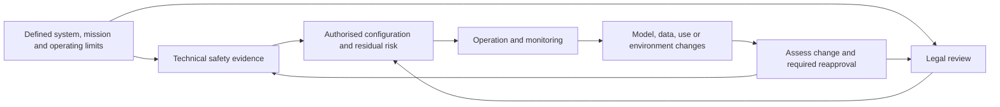

# The brakes exist. The public evidence of their operation is fragmented.

**F5 investigation | Evidence cutoff: 25 October 2026 | New work anchored to immutable F4 commit `fa55e8d3d7c69bfc1051279185c7c88df8e92cb6`.**

The US and its allies have built an overlapping architecture for restraining autonomous systems: legal weapons reviews, engineering safety boards, software assurance, human authorisation, operational limits, and safeguards that monitor or interrupt unsafe behaviour. Public records support the existence and scope of these mechanisms. They support some trials and specific procurement activity. This source set did not yield a complete chain from a particular trained model, through its approved mission limits, to an independently tested safeguard on a fielded weapon.

That distinction changes the reporting question. The task is to find the decision that changed a design, restricted a mission, required new evidence, or accepted residual risk—and then follow what happened when the model or operating environment changed. An institution's existence does not establish effective control; a missing public case file does not establish that control is absent.

This investigation corrects several starting hypotheses. Autonomous software is not automatically SwCI 1 under MIL-STD-882E. A neural network can give deterministic outputs while remaining uncertain outside its tested data distribution. STANAG 4406 governs military messaging. The United States has not ratified Additional Protocol I, but its own policies require legal weapons review and relevant modification review. Patents disclose proposed mechanisms, not deployment or certification. November 2026 events remain future at this cutoff.

## Three supported story hooks

1. **The current US ML safety guide exposes the assurance boundary.** The January 2026 guide does not supply a supervised-ML level-of-rigor column for the most safety-critical function category. It recommends independently assured safeguards and treats deployment at that category as elevated risk; it does not prohibit it. The document is informational guidance subject to approval authorities. The concrete reporting lead is which programme used which boundary, with what evidence and risk acceptance. [Current guide, preface viii and printed pp.26–28,41](https://www.cto.mil/wp-content/uploads/2026/01/MLSSEG-8January2026-Cleared.pdf).
2. **Assurance evidence can become a dependency in procurement and updates.** MOD's CARRION direct-award justification says switching the incumbent would require rebuilding integration and assurance evidence. Its proposed signature on 27 October remains future. Shield AI separately describes UK approval/update friction; ENAC records a bounded V-BAT flight permission, preventing a universal rejection claim. These are different evidence tiers, not proof of an unlawful bypass. [Buyer notice](https://www.sell2wales.gov.wales/search/show/search_view.aspx?ID=OCT666902&catID=), [supplier testimony](https://committees.parliament.uk/writtenevidence/168308/html/), [regulator register](https://moduliweb.enac.gov.it/applicazioni/sapr/APR_Lista_Unificata.asp?Ricerca=2026).
3. **The update problem is an execution test for existing rules.** US and allied review policies already address changed weapons and uses. Meanwhile, GAO's 14 October 2026 report documents a lapse in the US Responsible AI Working Council and a staffing shortfall in CDAO's Responsible AI Division, alongside actual implementation activity. The council resumed; its staffing evidence is dated February 2026 and does not describe every safety board. The supported story is how version control, review triggers and institutional capacity meet rapid updates—not an established legal loophole or named bypass. [GAO](https://www.gao.gov/products/gao-27-107837), [US Army review rule §6](https://armypubs.army.mil/epubs/DR_pubs/DR_a/pdf/web/ARN8435_AR27-53_Final_Web.pdf).

These are supported angles, not claims to exclusivity. No named US commercial autonomy vendor's failure of JSP 936 certification, or deliberate bypass by DAWG, Project Agincourt or a transfer programme, was established in this record.

## Follow the approved configuration, not a universal certificate

A safety review asks whether a system can cause an unintended hazardous event. Airworthiness and maritime assurance ask different questions about operating a platform. A weapons lawyer considers the weapon's nature, expected use and applicable law. NATO interoperability standards can enable compatible control without certifying legal target selection. Human authorisation can be a real barrier, yet its effectiveness depends on information, time, workload and authority. These mechanisms overlap without substituting for one another.

This is an analytical map of assurance, not a universal institutional workflow. Its most valuable investigative object is the authorised configuration: model/version, data assumptions, mission limits, operator role, hazard controls, review conditions and change authority. None of the five domains examined supplies a single public certificate covering every element.

## Five Eyes and AUKUS: genuine process, uneven visibility

The UK directive is **JSP 936 Part 1 V1.1, November 2024**, *Dependable Artificial Intelligence (AI) in Defence*. It operates across the lifecycle and permits context-dependent tailoring with managed additional risk. It does not establish a categorical requirement that every supplier surrender all training data and weights. The September 2025 Turing study documents problems with responsibilities, assurance skills, mission metrics and testing infrastructure. Its opening lab-ready drone scene is explicitly fictional: it cannot be reported as an actual rejected purchase. [Directive](https://www.gov.uk/government/publications/jsp-936-dependable-artificial-intelligence-ai-in-defence-part-1-directive), [Turing study](https://www.turing.ac.uk/sites/default/files/2025-09/defence_ai_assurance.pdf).

DAIC's 2026 material supplies a stronger current development: versioned system cards, ownership of records, monitoring for drift and significant-change escalation. Keeping the cards inside teams may make public or cross-programme tracing harder; that is an inference about evidence access, not proof of weak assurance. The May 2026 Turing/DAIC resilience study also makes infrastructure and human-interface conditions part of the assurance context. A model benchmark alone cannot answer whether a degraded system gives an operator misleading information. [Current framework](https://www.digital.mod.uk/policy-rules-standards-and-guidance/aiph/development/guidance-on-system-cards), [resilience study](https://www.turing.ac.uk/sites/default/files/2026-05/the_alan_turing_institute_daic_-_resilient_defence_ai_report.pdf).

Australia's published work separates human trust calibration, ethical planning and vessel safety. DSTG's agent-transparency report dates to 2017; the Australian autonomous-vessel code is Edition 1, April 2022, despite its 2026 hosting path. A code developed for domestic commercial vessel entry into service is not evidence of approval for a weapon's engagement function. The ethical-AI method's official brochure also warns that the workshop report is not an official Defence position. Canada's AI strategy and IDEaS trust-calibration challenge demonstrate policy and research activity, including an interest in independence and sovereignty; challenge funding availability is not expenditure and is not a named supplier-rejection decision. [Detailed dossier](memos/01-five-eyes-aukus-certification.md).

AUKUS demonstrations establish particular integration experiments, such as reciprocal control and communications. They do not publish the complete failure-condition tests, legal opinions or approved weapon configurations. HyFliTE is a hypersonic testing collaboration, not a general AI certification gate. The May 2026 ministerial statement's UUV payload project says delivery begins in 2027. Dstl's Novel Autonomy competition listed feedback for 31 October 2026 and intended contract starts in November: neither had happened by the cutoff. Its available competition pot cannot be described as verified disbursement. [AUKUS statement](https://www.gov.uk/government/publications/aukus-defence-ministerial-joint-statement-30-may-2026/aukus-defence-ministerial-joint-statement-30-may-2026), [competition](https://www.gov.uk/government/publications/novel-autonomy-and-robotics-phase-1).

Shield AI's specific testimony is stronger evidence of reported friction than a fictional laboratory scene, but still needs a regulator and customer response before its account can be independently resolved. The October 2025 MAA notice is informative guidance, not itself a new regulatory requirement. It identifies architectural mitigation and assurance difficulties without deciding the V-BAT case. [Attribution and source limits](memos/01-five-eyes-aukus-certification.md).

MOD's CARRION notice supplies buyer-side evidence of assurance dependency. It cites proprietary baseline artefacts and the cost/risk/delay of rebuilding integration and assurance activity as reasons for a proposed direct award to Applied Intuition. The £4,977,790 value excluding VAT is proposed, with estimated signature 27 October 2026. The scope expressly excludes range/safety services and airworthiness/certification activities: assurance-related switching costs are not the same as buying an operational safety certificate. The related Rowden notice also remains pending. [Notice and boundary](https://www.sell2wales.gov.wales/search/show/search_view.aspx?ID=OCT666902&catID=).

ENAC's operator register adds a counterweight to Shield AI's UK complaint: it records Global Sat's bounded V-BAT BVLOS authorisation from 8 June to 31 July 2026. That permission had expired by this cutoff, with no renewal established by the row; it is flight permission, not weapon/legal-stack approval. [Register, reference 53278](https://moduliweb.enac.gov.it/applicazioni/sapr/APR_Lista_Unificata.asp?Ricerca=2026).

## NATO and Europe: standards have different jobs

NATO's DARB charter envisages a responsible-use process standard for the NATO Enterprise, with voluntary adoption by nations. Announcements that work began on certification are not an authenticated issued vendor questionnaire, and a research paper measuring the Principles of Responsible Use is not Alliance acquisition policy. The final public questionnaire/toolkit was not recovered and authenticated in this run; that remains a verification gap. TR-HFM-330 is human-systems-integration research about meaningful human control, not a weapon-specific certificate. Some STO catalogue/full-text endpoints were inaccessible; the dossier distinguishes retrieved material from indexed metadata. [DARB charter](https://www.nato.int/en/about-us/official-texts-and-resources/official-texts/2022/10/13/natos-data-and-artificial-intelligence-review-board), [TR-HFM-330](https://www.sto.nato.int/document/human-systems-integration-for-meaningful-human-control-over-ai-based-systems-report/).

NATO's own DIANA financial audit shows a different friction point. IBAN reported gaps in financial substantiation for grants and TEVV expenses. Its opinions on the financial statements and compliance were unqualified; management said test reports were submitted and accepted. Missing payment substantiation must not be recast as proof of missing or failed testing. [2024 audit, publicly disclosed in 2025](https://www.nato.int/content/dam/nato/webready/documents/iban/financial-audits/PO%282025%290336%20NU%20ENG%20-%20DIANA%202024%20FS%20-%20public%20disclosure.pdf).

Identifier checks matter. AOP-52 Edition B Version 1, November 2016, describes itself as a reference rather than a compliance document. STANAG 4187 Revision 5 implements AOP-4187 Edition A on fuzing safety; STANAG 4406 Revision 2 concerns military message handling; STANAG 4586 Revision 4 concerns UAS control interoperability/AEP-84. Treating them as interchangeable autonomous-weapons safety certificates would create a fictitious architecture. Adoption, contractual applicability, national reservations and evidence of a particular implementation still require programme-level checking. [Standards and locators](memos/02-nato-darb-sto-and-edf-guardrails.md).

EDF's 2026 call material contains specific human-authority, explainability and update-security requirements. The MSAI research topic's indicative €16 million allocation is particularly useful: its eligibility table does not present it as qualification/certification activity. The EMSAS topic separately has an indicative €90 million allocation and distinguishes human-on-the-loop missions from human-in-the-loop weapon engagements. These are scoped requirements, not verified funded outcomes. The claimed €262 million AI/autonomy category was not verified as the official programme total. SecureAI's €21.2 million Horizon/ECCC call is a separate civilian cybersecurity funding instrument; a deadline and allocation do not establish funded consortiums, defence deployment or kill-switch delivery. [Official call descriptions](https://defence-industry-space.ec.europa.eu/document/download/2cd25753-d14f-4019-8fdf-68cca55b7f17_en?filename=EDF+2026+Call+Topic+Descriptions.pdf).

## US safety boards: stronger than an ethics label, narrower than a legality guarantee

MIL-STD-882E Change 1 is dated **27 September 2023**. Software control category and mishap severity jointly determine software criticality and required rigor at the relevant function. An autonomous function is not automatically SwCI 1. The standard's incomplete-rigor risk-acceptance route is a formal process; it is not proof of a waiver for a named neural-network weapon and cannot waive legal obligations. [Standard](https://www.cto.mil/wp-content/uploads/2025/07/MIL-STD-882E-w_CHANGE-1.pdf).

The current supervised-ML guide confronts assurance limitations more directly than the generic standard. It distinguishes repeatable inference from uncertain performance in unfamiliar conditions, discusses independent safeguards, and calls for renewed testing when models are retrained or updated. Its treatment of learning differs from a blanket demand for deterministic source code. Hardware is not the only possible form of safeguard. Its scope and authority must remain visible: informational recommended approaches, supervised learning, tailored through competent authorities. It is not a public record of which fielded weapon complied. [Guide](https://www.cto.mil/wp-content/uploads/2026/01/MLSSEG-8January2026-Cleared.pdf).

The Navy's WSESRB, software-safety and fuzing panels form part of a real institutional review structure; the current joint-services instruction also assigns AI-related support responsibilities. Supporting safety engineering contracts and range-safety systems establish activity outside explicitly labelled ethics research. Flight termination and containment can bound a vehicle hazard, but cannot by themselves establish lawful distinction, proportionality or precautions in an attack. No documented board decision on Bullfrog, AimLock or the named Eglin seeker hypothesis was established by this source set. [Safety dossier](memos/03-us-munitions-safety-boards-mil-std-882e.md).

## The financial correction: a slice is not an award

F5 verified the three supplied archive hashes and read **712,186 physical financial-index rows, also 712,186 unique transaction keys**. It screened **886,629 descriptive observations** across the associated contract/capability/research-grant material. These are different denominators, not additive awards. Exact joins yielded **102 machine-hit candidates**, including the two required lifecycle checks. A ten-case reporting tier is distinguished from 92 supporting machine hits; machine relevance is not a finding that each award funds an autonomous safeguard.

A new live retrieval—not republication of F4—exhausted unfiltered USAspending transaction histories and exact-identity FPDS feeds for all 102 candidates. The result contains **1,053 actions in each related source view**, including **104 negative FPDS actions**. The current 102 award aggregates reconcile to each action ledger. USAspending and FPDS are presentations of related agency reporting, not independent observations of performance. No aggregate dollar total is offered as a global safety budget.

| Exact agency/PIID and parent | Archive actions | New live actions in each view | Net reported award obligations |
|---|---:|---:|---:|
| 9700 / N0042123F3004; parent 9700 / N0017819D7484 | 3 | 53 | $27,836,455.94 |
| 9700 / N0016422F3007; parent 9700 / N0017819D7763 | 6 | 19 | $24,423,706.49 |

The first is a DCS award with two negative actions; its recorded current performance end is 31 May 2027. The second is a Herren Associates award with a recorded current end of 5 July 2026. That date does not prove termination or absence of later activity. Signature dates are separately retained, as are old base modifications, negative actions, options/ceilings and reporting limitations. These whole-award net obligations are not cash outlays or the price of a legal governor.

Newly identified concrete scopes include ENSCO common flight-safety-system independent verification/validation, Textron quadrotor-autonomy flight termination, Soldier UAS safety engineering and a universal safe-and-arm module. Their precise identities and newly reconciled action histories are in the Drive audit. The public description establishes purchased scope, not completed capability, deployment or effectiveness. Recipient identity checks preserve UEIs and do not recast legacy DUNS identifiers as conflicting UEIs. No prime/subaward/IDV ceiling addition is used. Full raw bodies, request logs, validation results and discovery dispositions are delivered on Drive through [the manifest](DRIVE_DATA_MANIFEST.json).

A separate live follow-up found Anduril's **HR0011269E126**, agency 9700, under FPDS's native **OtherTransactionAward** schema for AIS/ADS-B high-assurance software. Three disclosed FPDS actions reconcile to that feed's reported aggregate. Exact-PIID USAspending discovery did not recover a mapping; no award key was invented and no missing endpoint was treated as proof of absence. It is a separately bounded lead, outside the 102 two-view reconciliations. Five additional targeted FAR follow-ups—BCI, Torch, INSPIRD and two distinct Penta instruments—were separately hydrated after the archive screen. The final file therefore contains **108 identities: 107 FAR two-view reconciliations and one FPDS-only OT**. It retains **1,192 USAspending actions, 1,195 FPDS actions and 113 negative FPDS actions**. Independent validation checked **412 referenced raw response hashes**. These final totals do not alter the original 102-candidate screen denominator. The OT is not represented as a completed USAspending reconciliation. This scope concerns assurance research, not proven legal restraint of a weapon. The two Penta instruments remain separate awards; a shared recipient does not justify transferring money or technical scope between them. BCI’s whole award is not a board-specific expenditure total.

## Patents show design choices, not deployed brakes

The patent register distinguishes priority, filing, publication and grant dates, and collapses obvious same-family documents for interpretation. A 2026 publication can descend from a much older priority claim. Google Patents' listed assignee and legal-status labels are not an audited current chain of title. CPC/keyword/assignee searches are discovery aids with noisy results, not evidence that no other patent exists.

Kongsberg's **US11946710B1**, BAE's **US11768065B2**, runtime-assurance and flight-safety filings provide functional evidence of proposed authorisation, safety-boundary and containment architectures. BAE's family explicitly addresses separating safety-critical weapon functions from a general computing platform; this is a concrete certification-related design rationale. It does not prove a product received certification or that all its legal decisions were constrained. Civilian vehicle and delivery examples are labelled comparators. Incorrect search-result associations—such as treating a NASA geo-containment patent as Shield AI's—are rejected. [Claims, metadata and family limits](memos/04-patent-and-hardware-interlocks.md).

The register intentionally omits schematics, component values, firing-control code and instructions for bypassing safeguards. Exact claim numbers and sources let a journalist examine the governance implication without turning the dossier into a weapon design manual.

## Legal review and continuous updates: the rule is not once-only

Article 36 binds parties to Additional Protocol I to assess new weapons, means or methods in their study, development, acquisition or adoption. The US signed but has not ratified that Protocol; its weapons-review duties must be described through applicable US policy and other law, not automatic Article 36 treaty membership. A legality opinion also does not decide that every future use of a weapon will be lawful. [ICRC treaty record](https://ihl-databases.icrc.org/en/ihl-treaties/api-1977/state-parties).

DoDD 3000.09 and the DoD Law of War Program require relevant modification review. Army AR 27-53 §6(f) addresses changes to capability, intended use or reasonably anticipated effects that invalidate the prior review's assumptions; its rapid-fielding provisions preserve review. UK and Australian material similarly directs attention to material changes, context and intended use. This does not mean every numerical weight change automatically requires the same full review: the decision depends on the policy, significance and changed assumptions. The empirical issue is who makes and records that judgement, and how the released configuration remains traceable. [Legal dossier](memos/05-article-36-legal-reviews-and-software-updates.md).

A concrete counterexample to the claim that reviews never impose conditions is the Netherlands' 2021 SMASH2000 opinion. Its final conditions restricted permitted use and required training/testing. In February 2026, an official parliamentary answer called the opinion binding and stated that new versions would be reassessed. The government described SMASH as an aiming aid, not an independent weapon. This does not establish that every 2021 condition applies unchanged to SMASH3000 or that conditions were followed in operations. [2026 answer 16](https://zoek.officielebekendmakingen.nl/ah-tk-20252026-1049.html), [original opinion](https://www.rijksoverheid.nl/documenten/2021/08/13/advies-18-gebruik-smash-2000-smart-shooter).

Currentness adds a real complication. NSPM-11 of 5 June 2026 ordered revision of DoDD 3000.09 and rescinded/replaced NSM-25. An instruction to revise is not proof a revised directive was issued. The public 2023 directive's status and any implementing changes must be checked against authenticated publication, rather than treating a lapsed deadline as evidence of repeal. [NSPM-11](https://www.whitehouse.gov/presidential-actions/2026/06/national-security-presidential-memorandum-nspm-11/).

A useful vendor counter-source is Shield AI's August 2026 explanation of a governed model release process: it distinguishes mission-time adaptation from in-mission retraining. This is an attributed company description, not independent assurance. Its December 2025 runtime-assurance announcement likewise described tests and an intended mid-2026 SDK availability; intention is not verified release or weapon certification. Anduril UK's February 2026 teaming with AtkinsRéalis concerns navigating MAA/CAA assurance pathways, not an approval already granted. These sources complicate the universal black-box failure hypothesis without proving their systems safe or lawful. [Shield AI](https://shield.ai/autonomy-at-the-speed-of-the-mission/), [Resilient Shield](https://shield.ai/resilient-shield-strengthening-hivemind-for-safe-real-world-flight/), [AtkinsRéalis](https://www.atkinsrealis.com/en/media/trade-releases/2026/2026-02-17).

## What a journalist can responsibly pursue next

For each promising programme, seek an approval chronology with the authorised configuration, significant-change decision, conditions imposed, retesting and residual-risk acceptance. Public-release requests would be a next reporting step; none was submitted in this investigation. Cross-check the agency, supplier, test organisation and review authority, recognising that contract databases are not independent corroboration of technical performance.

The strongest evidence here concerns the architecture's existence, source identities, published scope, specific procurement histories and documented institutional friction. Effective operational legal restraint remains case-specific and largely unverified. F5 neither establishes an exhaustive global absence nor proves a universal operational legal governor. Engineering reliability matters to lawful use, while remaining insufficient to establish complete legal compliance.

## Delivery and verification

Read the five thematic dossiers for source-specific limits and the ranked [75-source reading pack](READING_PACK.md) for starting points. Heavy tables, exact public API snapshots, complete bundle member inventories, the three-round actual editor–reporter exchange log and the paid-search ledger are linked in [DRIVE_DATA_MANIFEST.json](DRIVE_DATA_MANIFEST.json). Local portable validation and independent response/hash checks are reported separately from publication checks; no hosted CI success is claimed.

Exa spending and final publication verification are recorded in the final delivery note. This task sends no email and creates no automation; the parent thread owns the single scheduled 06:00 Europe/Rome briefing.
