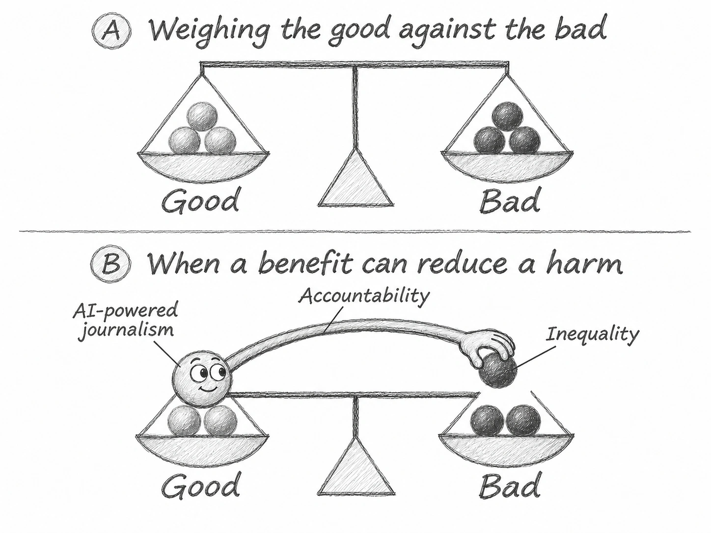
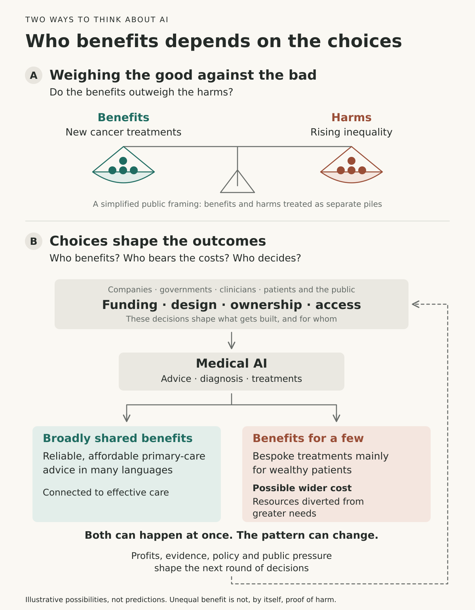

# AI: weighing outcomes and shaping outcomes

8 November 2026. Conceptual research note developed from Graeme Smith's sketch.

## Revised illustration: a benefit that could reduce a harm



Panel A keeps the simple Good-versus-Bad scales. In Panel B, a ball on the Good side comes alive, with eyes and a long arm reaching across to pluck a ball from Bad. It represents AI-powered journalism: a benefit that could strengthen accountability and, in part, offset inequality-related harms. This is a proposed relationship, not an established outcome or a measured effect.

[Illustration prompts](journalism-illustration-prompt.txt). The current version uses a 4:3 landscape layout, greyscale graphite shading and hand-lettered text. The [earlier portrait pencil version](ai-journalism-accountability-pencil.webp), [earlier colour version](ai-journalism-accountability.webp) and original diagram are also retained.

## The point

AI's benefits and harms are partly produced by decisions about what to build, who controls it, who can use it and who bears its costs. They can occur simultaneously, and their distribution can change over time. A successful treatment and an unfair health system can coexist.

The diagram contrasts a familiar public framing—put the benefits and harms on scales—with a second question: how do choices shape those outcomes? Its return arrow shows how profits, evidence, policy and public pressure can influence the next round of decisions. This is an explanatory model, not a forecast or a measured estimate of AI's effects.



- [Editable vector figure](ai-outcomes-diagram.svg)

The high-resolution PNG is supplied with the conversation. The complete editable figure is backed up here; the rendering instructions below reproduce the PNG.

## What the drawing improves

The actors are named: companies, governments, clinicians, patients and the public. They do not have equal power. Funding and ownership affect which medical tools are developed, as well as who receives them. The two outcomes can coexist; the arrows do not imply an exclusive choice between two possible futures or a fixed quantity of good and bad.

The examples are conditional. Affordable advice improves health only if it is reliable, appropriate to its users and connected to effective care. Personalized treatment is not inherently a harm. The possible harm is exclusion or the diversion of scarce resources from more important needs; establishing diversion requires evidence about what those resources would otherwise have supported.

The comparison is with a simplified public framing, not with every form of cost-benefit analysis. Careful evaluation can already consider distribution, uncertainty, alternative policies and change over time.

The cure can work, and the arrangement around it can still be unfair. The useful questions are whose problem was worth solving, who got treated, who was left waiting, and who has the power to change the arrangement.

## 2026 readings

### Closest conceptual match

**Atsushi Nakagomi. “AI and the Reproduction of Health Inequity: Redistribution-Translation-Accumulation Framework.”** *Journal of Medical Internet Research*, 28:e98158, 6 October 2026. Journal viewpoint. [Full text](https://www.jmir.org/2026/1/e98158). DOI: 10.2196/98158.

Connects resource distribution, the conversion of social advantage into health advantage, and effects that accumulate over time. Those mechanisms can widen or narrow gaps. A conceptual framework, not a measurement of AI's global net effect.

### Who is entitled to benefit?

**Iason Gabriel and Atoosa Kasirzadeh. “The Case for Globally Beneficial Technology.”** First posted 4 July 2026; revised 7 July 2026. Preprint; no journal publication verified. [Paper](https://arxiv.org/abs/2607.03906).

Argues that everyone has a moral claim to benefit from major technological advances. That claim affects design and development as well as distribution. The authors disclose employment at Google DeepMind; the argument should not be mistaken for a statement of company policy.

### Who chooses the objectives?

**Maximilian Kasy. “The Political Economy of AI: Toward Democratic Control of the Means of Prediction.”** *The Oxford Handbook of Algorithmic Governance and the Law*, 24 March 2026. [Author-hosted published chapter](https://maxkasy.github.io/home/files/papers/handbook_politicalecon_ai.pdf). DOI: 10.1093/9780191996030.003.0006.

Examines conflicting interests and control over what systems are designed to achieve. This supports the focus on power and distribution, but Kasy also explicitly endorses comparing individual gains and losses. The chapter was published in 2026; its first draft was submitted in November 2022.

### Follow financing, infrastructure and power

**Janet Vertesi, danah boyd, Alex S. Taylor and Benjamin Shestakofsky. “Reckoning with the Political Economy of AI: Avoiding Decoys in Pursuit of Accountability.”** Association for Computing Machinery Conference on Fairness, Accountability, and Transparency, 25 June 2026, pp. 2186–2205. [Open manuscript](https://arxiv.org/html/2604.16106v2). DOI: 10.1145/3805689.3806739.

Argues that familiar AI debates can obscure the financial and institutional relationships that shape development. A forceful interpretive argument; it does not establish that every safety debate is a deliberate distraction.

### Benefits and harms within the same project

**Aaron Su. “AI as pharmakon: Authoring Indigenous futures in Taiwan.”** *American Ethnologist*, 53(2):128–131, first published 16 April 2026. Scholarly commentary. [Publisher abstract](https://anthrosource.onlinelibrary.wiley.com/doi/abs/10.1111/amet.70086). DOI: 10.1111/amet.70086.

Examines language revival alongside environmental burdens associated with AI infrastructure. Its remedy-and-poison metaphor captures simultaneous consequences. Only the abstract and references were accessible; they do not establish a quantified environmental footprint attributable to the particular project.

### Closest to the personalized-medicine example

**Raef Kozman and Fabrice Jotterand. “The dis-economy of precision medicine: how stratification multiplies social tension in healthcare systems.”** *Medicine, Health Care and Philosophy*, 29:923–930, 11 July 2026. Philosophical article. [Full text](https://link.springer.com/article/10.1007/s11019-026-10381-z). DOI: 10.1007/s11019-026-10381-z.

Explores how improved biological prediction changes eligibility, insurance and access to treatment. More accurate information can support care or exclusion. Broader than AI, and explicitly not a claim that precision medicine is always wasteful or clinically undesirable.

### A challenge to the apparently beneficial branch

**Soumyadeep Bhaumik. “Beyond gender and racial bias: Towards pro-justice ethical GenAI use in medicine and health.”** *Women's Health*, 24 June 2026. Editorial. [Full text](https://journals.sagepub.com/doi/full/10.1177/17455057261464214). DOI: 10.1177/17455057261464214.

Warns that widely available automated advice could become an inferior tier of care for disadvantaged people. This is a question to investigate, not proof that all inexpensive AI care has that effect.

### Book-length philosophical treatment

**Seth Lazar. *The Algorithmic City: Power, Justice, and AI*.** Oxford University Press; online publication 30 October 2026; print availability listed for 10 December 2026. [Book](https://academic.oup.com/book/63611). DOI: 10.1093/9780197787977.001.0001.

Examines how algorithmic systems structure social relationships and exercise power. Useful for asking what makes that power legitimate. The book develops earlier Tanner lectures; 2026 is its publication date, not the origin of the underlying ideas.

## Sources and technical notes

### Scope and verification

- This was a targeted reading search, not a systematic literature review. Selection prioritized conceptual similarity to the sketch and publicly verifiable publication dates by 8 November 2026.
- Searches covered health equity, precision medicine, distributive justice, political economy, governance and simultaneous benefits and harms. Candidates were checked against publishers, university records or author-hosted manuscripts.
- Nakagomi, Bhaumik and Kozman/Jotterand were checked against publisher full texts. Kasy was checked against the published chapter hosted on his website. Vertesi and colleagues were checked against the open manuscript and the [University of Edinburgh publication record](https://www.research.ed.ac.uk/en/publications/reckoning-with-the-political-economy-of-ai-avoiding-decoys-in-pur/).
- Gabriel/Kasirzadeh were checked against the [arXiv version history](https://arxiv.org/abs/2607.03906) and [full text](https://arxiv.org/pdf/2607.03906). Their [SSRN record](https://papers.ssrn.com/sol3/papers.cfm?abstract_id=7059178) carries their employment disclosure.
- Su's publisher abstract and bibliography were checked; full-text access was unavailable. Lazar's publisher metadata, book abstract and [first lecture](https://academic.oup.com/book/63611/chapter/583708894) were examined.
- Publication form is identified above because a viewpoint, editorial, preprint and theoretical article are not interchangeable with an empirical impact evaluation.
- None of the selected readings establishes that AI-designed bespoke medicines currently divert a measured amount of resources from global primary care. That remains a separate reporting proposition.

### Original vector figure: construction

The figure was newly drawn as editable Scalable Vector Graphics (SVG), using exact text and vector shapes, from the user's conceptual sketch. The uploaded photograph was not altered or included in the repository. No image-generation model was used for the original vector figure. The SVG has a 1200 × 1540 coordinate space, a title and a descriptive text alternative. The PNG was rendered at 3000 × 3850 pixels with Sharp and visually inspected. No numerical data are encoded; circle counts and the level scales are illustrative.

To reproduce the PNG with Node.js and the Sharp package installed:

```javascript
const sharp = require('sharp');
sharp('ai-outcomes-diagram.svg', { density: 180 })
  .png()
  .toFile('ai-outcomes-diagram.png');
```

The diagram is an original synthesis of the sketch and the selected arguments. It is not reproduced from an academic figure, and the listed authors should not be understood as endorsing it.

### Revised cartoon: construction and backup

The revised cartoon was made with the built-in image-generation tool, then restyled with the same tool at the user's request as a greyscale pencil sketch with hand-lettered text. Both earlier portrait PNGs—the colour version and the first pencil version—were generated at 1107 × 1421 and are retained in the conversation. Their same-dimension [portrait pencil WebP backup](ai-journalism-accountability-pencil.webp) and [colour backup](ai-journalism-accountability.webp) were encoded at quality 95. No design edits were made during conversion: these are encoding changes, not exact byte-for-byte copies of the original PNGs. The [illustration prompts](journalism-illustration-prompt.txt) record both the composition and style instructions.

A subsequent revision presents the same pencil cartoon in 4:3 landscape format. Its [WebP backup](ai-journalism-accountability-pencil-4x3.webp) is the primary figure above; the earlier images remain available.

### 4:3 landscape revision

The final landscape image is 1448 × 1086 pixels, exactly 4:3. It was reframed with the built-in image-generation tool, preserving the two stacked panels, pencil style and hand-lettered labels. The repository image is a quality-95 WebP conversion at those same dimensions. The [aspect-ratio revision prompt](journalism-illustration-4x3-prompt.txt) records this final edit.
